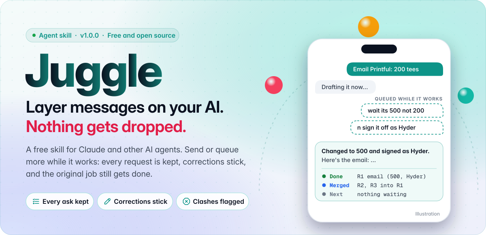
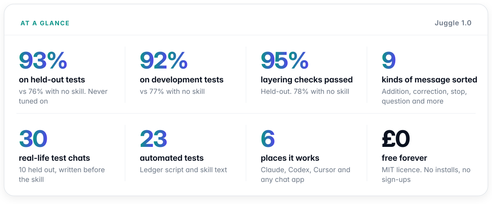
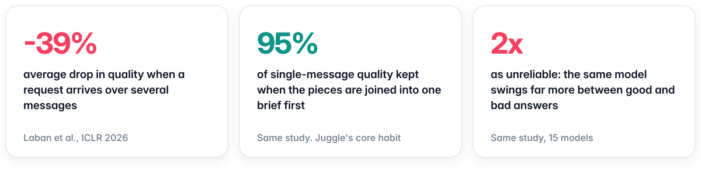
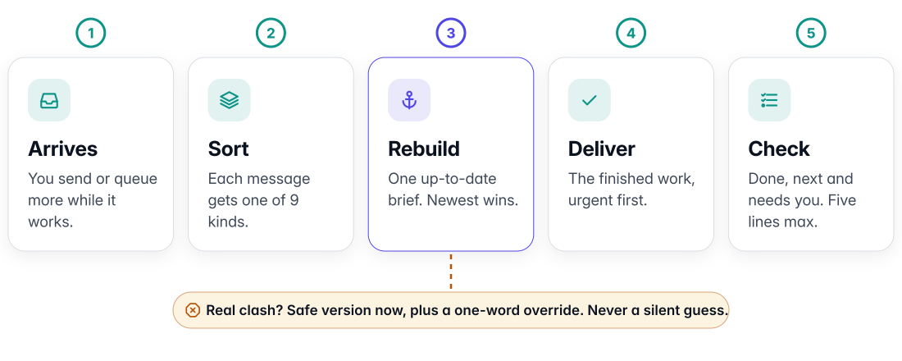
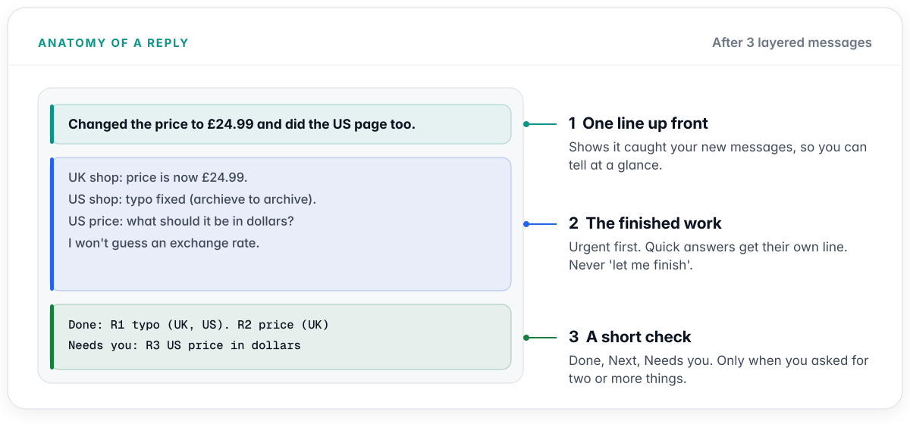
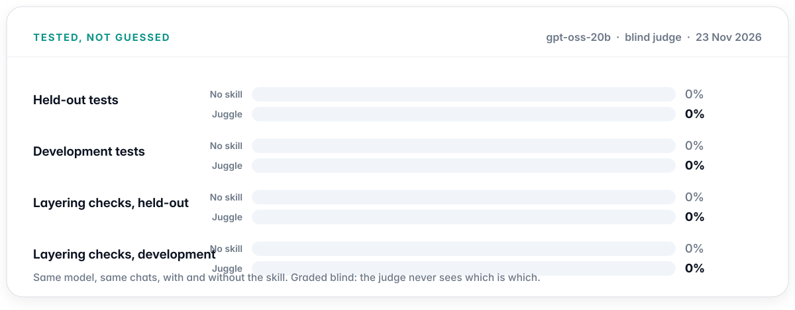
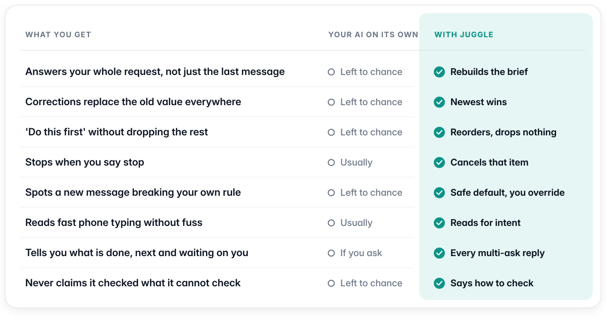

<a name="top"></a>

<picture>
  <source media="(prefers-color-scheme: dark)" srcset="assets/readme/hero-dark.svg">
  
</picture>

<p align="center">
  <a href="#install"><b>Install</b></a> &nbsp;·&nbsp;
  <a href="#how-it-sorts-your-messages">How it sorts</a> &nbsp;·&nbsp;
  <a href="#how-it-works">How it works</a> &nbsp;·&nbsp;
  <a href="#see-it-in-action">See it in action</a> &nbsp;·&nbsp;
  <a href="#tested-not-guessed">Results</a> &nbsp;·&nbsp;
  <a href="#faq">FAQ</a>
</p>

<p align="center">You type fast and think of things mid-task. <b>Juggle makes your AI keep up.</b></p>

<br>

<picture>
  <source media="(prefers-color-scheme: dark)" srcset="assets/readme/specs-dark.svg">
  
</picture>

<br>

## Install

Pick the tool you use. Every option is free.

<table>
<tr>
<td width="50%" valign="top">


Type these two lines into Claude Code:

```
/plugin marketplace add HYDERMAA/juggle
/plugin install juggle@juggle
```

</td>
<td width="50%" valign="top">


Any app that reads skills. One command:

```
npx skills add HYDERMAA/juggle
```

</td>
</tr>
<tr>
<td width="50%" valign="top">


Web or desktop chat. Three steps:

1. Download [`juggle.zip`](https://github.com/HYDERMAA/juggle/releases/latest). Do not unzip it.
2. Turn on **Settings > Capabilities > Code execution**.
3. Upload the zip under **Plugins** (once called **Customize**).

</td>
<td width="50%" valign="top">


One copy and paste:

Copy the box in [`paste-into-chat.md`](paste-into-chat.md) into your app's custom instructions. It fits ChatGPT's 1,500 character limit.

</td>
</tr>
</table>

<details>
<summary><b>Other ways: by hand, Cursor rule, AGENTS.md</b></summary>

<br>

**By hand, for any skill-aware agent**

```bash
git clone https://github.com/HYDERMAA/juggle.git
mkdir -p ~/.claude/skills
cp -r juggle/skills/juggle ~/.claude/skills/
```

Codex and other agents read `~/.agents/skills/` instead.

**Cursor:** copy [`.cursor/rules/juggle.mdc`](.cursor/rules/juggle.mdc) into your project's `.cursor/rules/` folder.

**Codex, Cursor, Aider and others:** copy [`AGENTS.md`](AGENTS.md) into your project's main folder.

</details>

<br>

## The problem

You ask for one thing. While the AI works, you remember three more, spot a mistake, or change your mind. So you send more, or queue them in Claude Code. Too often the AI answers only your last message, keeps the old number, or quietly forgets what you first asked for.

That is not just you. A 2026 study of 15 models found the same thing at scale:

<picture>
  <source media="(prefers-color-scheme: dark)" srcset="assets/readme/stats-dark.svg">
  
</picture>

<sub>Source: Laban, Hayashi, Zhou and Neville, <a href="https://arxiv.org/abs/2505.06120">LLMs Get Lost in Multi-Turn Conversation</a> (ICLR 2026). Juggle's core habit, rebuilding the brief before every reply, is the "join the pieces" fix from that paper, done by the AI itself.</sub>

<br>

## How it sorts your messages

Every new message is one of nine kinds, and each kind has its own rule.

<picture>
  <source media="(prefers-color-scheme: dark)" srcset="assets/readme/kinds-dark.svg">
  
</picture>

<br>

## How it works

<picture>
  <source media="(prefers-color-scheme: dark)" srcset="assets/readme/flow-dark.svg">
  
</picture>

<br>

### What a reply looks like

<picture>
  <source media="(prefers-color-scheme: dark)" srcset="assets/readme/anatomy-dark.svg">
  
</picture>

<br>

## See it in action

Real replies from the held-out test, before and after. Same model, same messages. Trimmed for length; full text in [`evals/real/runs/`](evals/real/runs/).

<table>
<tr><th width="30%">You sent</th><th width="35%">No skill</th><th width="35%">With Juggle</th></tr>
<tr>
<td valign="top">

1. Fix the failing test `test_checkout_total` (expected 24.99, got 2499)
2. *AI starts reading the code*
3. btw whats a good name for a newsletter about AI side hustles

</td>
<td valign="top">

> Here are a handful of snappy, memorable names that hint at both AI and the "side-hustle" vibe: … HustleBytes … Prompt Profits …

In all three tries, the failing test is never mentioned again.

</td>
<td valign="top">

> Fixed the `checkout.total()` to return pounds instead of pence, and here are a few catchy newsletter name ideas.
>
> **1. Fix for `test_checkout_total`** … `return total_pence / 100.0` …
>
> **2. Newsletter names** …

Both done, kept separate, in all three tries.

</td>
</tr>
<tr>
<td valign="top">

1. Today: reply to Sam's wrong-size complaint, write 3 tee slogans, plan Saturday's market stall
2. *AI starts on Sam's reply*
3. slogans first, printer needs them in 10 mins

</td>
<td valign="top">

> **T-shirt slogans (ready for printing in 10 min):** 1… 2… 3…
>
> Feel free to give me a … font choice, and I'll send a final pixel-perfect asset file …

In all three tries, Sam and the market stall are gone.

</td>
<td valign="top">

> **Slogans (first, in 10 min)** 1… 2… 3…
>
> **Reply to Sam (done)** Hi Sam, I'm really sorry to hear that the tee arrived in the wrong size …
>
> **Saturday market stall plan (next)** …

Urgent first, nothing dropped. (Best of three tries. The other two did the slogans first and listed the rest as next, though one forgot the stall plan.)

</td>
</tr>
</table>

<br>

## Tested, not guessed

<picture>
  <source media="(prefers-color-scheme: dark)" srcset="assets/readme/results-dark.svg">
  
</picture>

| | No skill | With Juggle |
| --- | --- | --- |
| **Held-out chats** (10, never used for tuning) | 76% | **93%** |
| **Development chats** (20, used while writing the skill) | 77% | **92%** |
| Layering checks only, held-out | 78% | **95%** |
| Held-out, using only the short [chat paste-in](paste-into-chat.md) | 76% | **94%** |

- **30 realistic chats**, each a first request, the AI starting work, then one to four layered messages: corrections, extras, questions, a stop, "do this first", a clash with an earlier rule, typo-heavy phone messages and the same message sent twice.
- **The held-out 10 were written and committed before the first line of the skill**, and a test makes sure none of their wording ever appears in the skill.
- **Model:** `gpt-oss-20b`, a small open model on a free endpoint, with and without the skill. **Judge:** the same model, twice per reply, blind to which version wrote it.
- **Honest limits:** small numbers (3 replies per chat), a lenient judge, and a small model, not Claude. Full method and per-chat tables: [`evals/real/README.md`](evals/real/README.md).

<br>

## With Juggle, and without

<picture>
  <source media="(prefers-color-scheme: dark)" srcset="assets/readme/compare-dark.svg">
  
</picture>

<br>

## For coding agents: the ledger file

In Claude Code, Codex or Cursor, when work runs over several turns or three or more requests are open, Juggle keeps the list in `.juggle/ledger.md`, plain Markdown you can open any time. It survives long runs and compaction.

```bash
python3 scripts/ledger.py add "Dark mode toggle on settings" --kind original   # R1 (doing)
python3 scripts/ledger.py add "Save button broken on mobile"                    # R2 (next)
python3 scripts/ledger.py add "Do not touch the header" --kind rule             # R3 (active)
python3 scripts/ledger.py set R1 done --note "Settings.jsx, header untouched"
python3 scripts/ledger.py check    # exit 1 while anything is still doing or next
```

<details>
<summary><b>What the ledger file looks like</b></summary>

<br>

```markdown
| # | Request | Kind | Status | Note |
|---|---|---|---|---|
| R1 | Dark mode toggle on settings | original | done | Settings.jsx, header untouched |
| R2 | Save button broken on mobile | task | doing |  |
| R3 | Do not touch the header | rule | active |  |
```

Statuses: `doing`, `next`, `done`, `changed`, `cancelled`, `needs-you`, and `active` for standing rules. A request sent twice is recorded once. IDs are never reused. One Python file, standard library only.

</details>

<br>

## FAQ

<details>
<summary><b>What does "layering" or "queueing" a message mean?</b></summary>

<br>

Sending another message while the AI is still working on the last one. In Claude Code, press **Enter** while Claude works and the message is queued; Claude Code hands it over as soon as the current tool calls finish, in the same turn ([docs](https://code.claude.com/docs/en/interactive-mode)). On the phone you see **Queue for after this turn**. In chat apps it is simply several messages in a row.

</details>

<details>
<summary><b>Will it make every reply longer?</b></summary>

<br>

No. For a single simple request nothing changes. When you asked for two or more things, it adds one line up front and a check at the end of five lines or fewer.

</details>

<details>
<summary><b>Will it keep asking me to confirm things?</b></summary>

<br>

Rarely. Most "clashes" are just corrections, and the newest message wins. It only asks when a new message breaks a rule you set earlier and getting it wrong would cost something, like a discount below your price floor. Even then it does the safe version straight away and lets you override with one word.

</details>

<details>
<summary><b>I type badly on my phone. Will it nag me?</b></summary>

<br>

Never. It reads for what you meant and never comments on spelling. It only checks with you when a word could mean two different things that lead to different results, like two products with the same name.

</details>

<details>
<summary><b>How is this different from other ledger or to-do skills?</b></summary>

<br>

Most keep a list of tasks across sessions. Juggle is about the moment a new message lands: what kind it is, whether to merge, queue, reorder or stop, how to protect the original request, and how to spot a clash with your own earlier rules. The list is a small part of it, and it is optional.

</details>

<details>
<summary><b>Does it work with Seatbelt?</b></summary>

<br>

Yes. [Seatbelt](https://github.com/HYDERMAA/seatbelt) keeps the building safe, Juggle keeps your requests intact. They do not overlap.

</details>

<details>
<summary><b>Is anything sent anywhere?</b></summary>

<br>

No. The skill is text, and the ledger script writes one local file. No accounts, no installs, nothing leaves your computer.

</details>

<br>

<p align="center">
  
</p>

<p align="center"><a href="#top">Back to top</a> &nbsp;·&nbsp; <a href="LICENSE">MIT licence</a> &nbsp;·&nbsp; <a href="evals/real/README.md">How it is tested</a></p>
